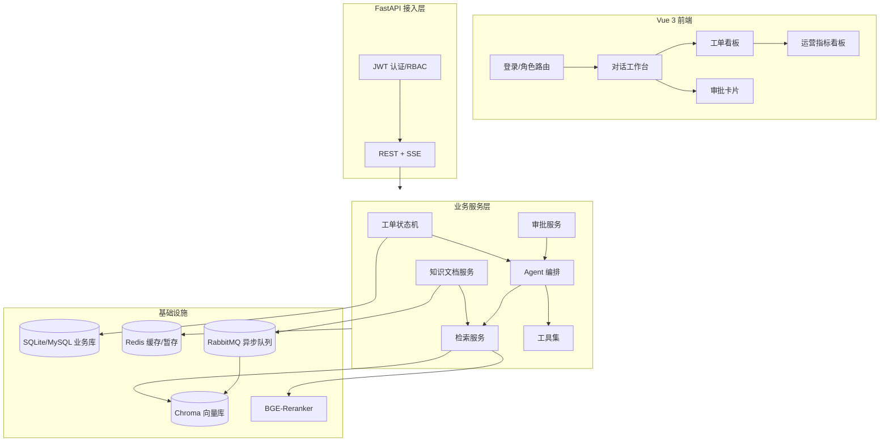
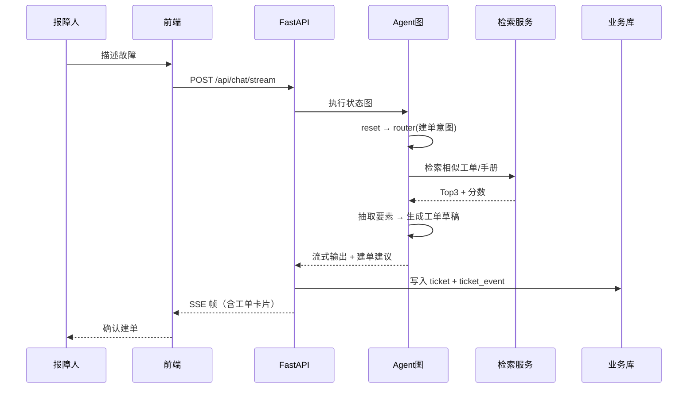

# 课设包装方案：把「DevSage 研发智库」改造成「智维台」企业服务台课设

> **依据**：`D:\phython\RAG_Personal\README.md` + 代码实读（`app/`、`frontend/`、`main.py`、`docs/`）
> **产出**：业务场景选型 → 课设任务书 → 需求/设计骨架 → 代码改造清单 → 答辩要点
> **说明**：本文所有技术参数均来自代码实读，不是 README 转述；凡标「待实测」的，必须自己跑出来再用。

---

## 0. 结论先行

| 项 | 结论 |
|---|---|
| 能不能包装 | **能，而且底子很好**：RAG + Agent + HITL + 异步任务 + 前端 + 部署 + 评测，课设要求的"技术深度"已经够了 |
| 缺什么 | 缺的不是技术，是**业务外壳**：现在讲的是"研发团队知识库"（开发者工具），课设要讲"某类角色 + 某条业务流程 + 某个可量化业务指标" |
| 推荐场景 | **C. 企业 IT 服务台 / 运维工单**（业务闭环最完整、与现有代码契合度最高、语料现成、指标清晰） |
| 推荐题目 | 《面向企业 IT 服务台的智能工单与知识协同系统设计与实现》——系统代号 **智维台（OpsDesk）** |
| 核心改造 | 把"知识库问答"升级为"**工单全生命周期 + 知识沉淀**"闭环：对话 → 建单 → 分派 → 排障（Plan-Execute-Verify）→ 审批 → 结案 → 沉淀为知识 |
| 工作量 | 复用 ~65%，改造 ~20%，新增 ~15%（新增约 1500–2000 行）。**新课设不能是"换个名字"，必须有新增模块** |
| 最大风险 | ①直接照抄 README 数据和结论 → 被追问穿帮；②提交物里残留"面试/参赛/GitHub/未来日期"痕迹 |

---

## 1. 现有项目资产盘点（课设视角）

代码规模实读：Python 62 文件 3867 行；Vue 8 文件 1044 行；JS 9 文件 1175 行；CSS 2072 行；旧 HTML 1178 行。**核心可复用代码约 6000 行**，对课设是"够厚"的。

| # | 能力 | 代码位置 | 课设可用性 | 说明 |
|---|---|---|---|---|
| 1 | 多格式文档解析入库 | `app/services/document.py`、`KnowledgeBase_md5_service.py` | ★★★★★ 直接复用 | PDF/docx/md/txt，chunk 500 / overlap 50，MD5 去重 |
| 2 | 异步上传链路 | `utils/rabbitmq.py`、`task_handler.py`、`redis_client.py` | ★★★★☆ 直接复用 | Redis 暂存 600s、Topic 交换机、内嵌 Worker、task_id 轮询、幂等键、失败重试 |
| 3 | 三阶混合检索 | `services/hyde.py`、`bm25_service.py`、`rerank.py`、`vector_store.py` | ★★★★★ 核心卖点 | HyDE + 向量(智谱 embedding-3) + BM25(jieba) + RRF + BGE-Reranker |
| 4 | 查询意图路由 | `services/tools/query_router.py` | ★★★★☆ 可讲工程 | 正则 → IDF → 默认 semantic 三层漏斗 |
| 5 | LangGraph 自定义图 | `agent/agent.py`（168 行） | ★★★★★ 核心卖点 | reset → router → retrieve → web → agent ⇄ tools，5 节点 + ToolNode |
| 6 | 工具集（7 个） | `services/tools/` | ★★★★☆ 改造为业务动作 | search / upload / delete / status / report / convert / send_email |
| 7 | HITL 人工审批 | `status_tool.py::send_email` + `api/chat.py::resume/pending` | ★★★★★ 课设加分项 | interrupt + SSE 中断帧 + checkpointer 持久化 + 防呆拦截 |
| 8 | 会话记忆 | `AsyncSqliteSaver` + `trim_messages(20)` | ★★★★☆ | thread_id = 用户_会话，重启不丢 |
| 9 | 双层缓存 | `utils/semantic_cache.py` | ★★★☆☆ 讲细节 | Redis MD5 + 语义相似（阈值 0.85，LRU 200）+ 一致性约束 |
| 10 | 认证与会话管理 | `api/auth.py`、`utils/auth.py`、`api/chat.py` | ★★★★☆ 需扩 RBAC | JWT、SQLite users、会话增删改查、标题自动生成 |
| 11 | Vue 3 前端 | `frontend/src/` | ★★★★★ | 登录/侧栏/聊天/审批卡片/设置，SSE + Markdown 渲染 |
| 12 | 工程化与部署 | `Dockerfile`、`docker-compose.yml`、`utils/logging_config.py` | ★★★☆☆ 写进"工程实现" | 三阶段构建、Redis+RabbitMQ+Worker、日志轮转、slowapi 限流 |
| 13 | 评测体系 | `eval_retrieval.py`(300题)、`eval_agent.py`(38题)、`eval_router.py` | ★★★★★ 课设最容易出彩 | Recall@K/MRR、五分类任务评测、断点续跑 |

**盘点的关键判断**：技术栈和时间成本都够，**真正稀缺的是"业务角色—业务流程—业务指标"三件套**。课设老师看的是"你为谁解决了什么问题、怎么证明解决了"，而不是"你用了多少框架"。

---

## 2. 课设验收视角的差距分析

以软件工程类课程设计的常见评分表为参照：

| 课设常见要求 | 现状 | 差距 | 补法 |
|---|---|---|---|
| 选题背景与业务痛点 | 有，但偏"开发者工具" | 业务角色模糊、无流程 | 换场景，见第 3 节 |
| 需求分析（用例、FR/NFR） | 无 | 完全缺 | 第 4.4 节给了 14 条 FR + NFR 表 |
| 系统设计（架构/模块/接口） | README 有架构图 | 缺模块划分表、接口清单 | 第 4.5 节 |
| **数据库设计（ER 图/表结构）** | 只有 `users` 表 + JSON 文件 + Chroma | 课设硬伤 | 新增工单/审计/知识条目等 10+ 表 |
| 关键算法与创新点 | 有（检索、HITL、缓存） | 缺"任务级"闭环 | 加 Plan-Execute-Verify |
| 系统测试（用例表/性能） | 有评测脚本，无测试用例表 | 缺文档化 | 补功能测试用例表 + 压测报告 |
| 项目管理（进度/分工） | 无 | 缺 | 第 5 节给了 8 周计划 |
| 可量化业务指标 | 只有检索/延迟指标 | 缺业务指标 | FCR、MTTR、转人工率、知识命中率 |
| 演示与可视化 | 有聊天界面 | 缺运营看板 | 加指标看板页 |

**结论**：差距集中在**"业务化"与"文档化"**两块，正好对应课设的两大评分维度（系统完整性 + 报告质量）。技术部分不用重做，只需增加业务层。

---

## 3. 业务场景三选一

### 3.1 三个候选场景

**场景 A：高校教务与学工智能咨询助手（校园事务）**

- 角色：学生 / 辅导员 / 教务老师 / 管理员
- 痛点：培养方案、学籍规定、奖助办法、办事指南散落，咨询重复量极大
- 闭环：提问 → 检索制度 → 带出处回答 → 办事指引 →（需人工）转辅导员
- 语料：20–40 篇制度文档（**最容易构造**，且老师熟悉、共鸣强）
- 业务指标：一次解决率、转人工率、平均响应时长
- 弱项：容易被认为是"校园问答机器人"，技术深度靠 RAG 撑，业务价值感偏弱

**场景 B：中小企业合同与合规审查助手（法务）**

- 角色：业务员 / 法务 / 管理员
- 痛点：合同条款风险靠人工逐条审，标准不一，历史合同难复用
- 闭环：上传合同 → 条款切分 → 风险条款比对 → 生成审查报告 → 法务审批（HITL）→ 邮件回传
- 语料：合同模板 + 法规条款 + 历史审查意见（**构造中等偏难**）
- 业务指标：风险条款召回率、审查耗时、人工复核率
- 弱项：法律专业性不足易被追问；语料造假的"味道"最重

**场景 C：企业 IT 服务台智能工单与知识协同（运维）**

- 角色：报障人 / 一线工程师 / 二线专家 / 服务台主管 / 管理员
- 痛点：设备手册、故障代码表、历史工单散落，新人排障慢，SLA 压力大
- 闭环：对话报障 → Agent 抽取要素建单 → 自动分派 → 检索手册+历史工单给排障步骤 → 高风险操作审批 → 结案 → 一键沉淀知识条目
- 语料：设备/系统手册、故障代码表、历史工单复盘（**现有"技术文档"语料可直接改造复用**）
- 业务指标：首次解决率 FCR、平均修复时长 MTTR、知识命中率、转人工率
- 弱项：与"研发智库"最像，必须靠"工单业务流"来做出区分度

### 3.2 加权评分（1–5 分）

| 维度 | 权重 | A 校园教务 | B 合同法务 | C 运维服务台 |
|---|---|---|---|---|
| 业务闭环完整度 | 25% | 4 | 5 | **5** |
| 与现有资产契合度（改造量越小分越高） | 25% | 3 | 4 | **5** |
| 语料/数据可得性 | 15% | **5** | 3 | 4 |
| 可量化指标清晰度 | 15% | 3 | **5** | **5** |
| 答辩防守难度（越高分越好守） | 10% | **5** | 3 | 4 |
| 演示效果 | 10% | 4 | **5** | 4 |
| **加权总分** | 100% | 3.85 | 4.25 | **4.65** |

**推荐 C，备选 B。** 若老师偏好"社会生活类"选题，用 A 也能过，但报告里必须把 A 写成"高校服务台"（工单化），否则撑不起系统设计章节。

### 3.3 30 秒业务故事（答辩开场直接用）

> 某制造企业有 1200 台办公与产线设备，IT 服务台每月收到 3000+ 工单。一线工程师遇到报障，先翻 800 页设备手册，再搜历史工单，平均 40 分钟才能给出第一步处置建议；二线专家 60% 的时间在回答重复问题。我们做了「智维台」：用自然语言报障即可自动建单，系统检索设备手册与历史工单给出带出处的排障步骤，高风险操作（批量关单、外发通报）必须人工审批，结案后一键沉淀为知识条目——目标是把首次解决率从 45% 提到 60% 以上，MTTR 从 40 分钟压到 25 分钟以内。

---

## 4. 推荐方案的课设设计书（可直接改成任务书）

### 4.1 课题名称

**主标题**：面向企业 IT 服务台的智能工单与知识协同系统设计与实现
**副标题**：基于 RAG 与 LangGraph Agent 的双引擎实现
**系统代号**：智维台（OpsDesk）
**备选代号**：知微 / 服务台智囊 / ServiceMate

> 起新名的意义：课设需要一个"自己的作品名"。DevSage 是既有项目名，直接沿用在提交材料里会显得"没做新东西"。

### 4.2 摘要（200–300 字，报告第一页用）

企业 IT 服务台面临"知识分散、排障依赖老员工、SLA 压力大"三类问题。本文设计并实现了一套面向服务台场景的智能工单与知识协同系统：以向量检索与关键词检索融合的三阶 RAG 链路解决"知识找不到"，以 LangGraph 状态图驱动的 Agent 实现"从对话到工单"的任务闭环，以人工审批中断机制（HITL）保证高风险运维操作可控，以工单结案沉淀机制实现"问题—知识"的正向循环。系统采用 FastAPI + Vue 3 前后端分离架构，引入消息队列实现文档异步入库、双层缓存降低重复查询延迟，并构建了 50 题任务级评测集与运营指标看板。实测表明：（此处填你复测后的真实数据，如任务完成率、FCR、P95 首字延迟、缓存命中率）。系统在（XX）并发下保持稳定，具备一定的工程可用性。

### 4.3 业务背景与流程

**现状流程（As-Is）**：用户电话/邮件报障 → 服务台人工登记工单 → 一线查手册/问老员工 → 解决不了转二线 → 处理完回填工单 → 经验留在个人脑子里。

**目标流程（To-Be）**：
1. 用户在对话框描述问题（可上传截图/日志）
2. Agent 抽取"设备、现象、紧急度、影响范围"四要素 → 生成工单草稿 → 用户确认
3. 系统按技能标签自动分派给一线工程师
4. Agent 检索手册 + 相似历史工单 → 输出带出处的排障步骤（Plan-Execute-Verify）
5. 涉及高风险动作（批量关单/外发邮件/发布知识）→ interrupt 审批
6. 结案 → 自动生成"故障复盘 + 知识条目草稿" → 主管审批 → 入库 → 下次可检索

这条流程里，**每一步都对应现有代码的一个能力**，这是选 C 的根本原因。

### 4.4 需求分析

#### 功能需求（FR）

| 编号 | 名称 | 描述 | 优先级 | 验收标准 |
|---|---|---|---|---|
| FR-01 | 多角色认证与权限 | 报障人/一线/二线/主管/管理员五类角色，接口级鉴权 | P0 | 越权访问返回 403，前端菜单按角色渲染 |
| FR-02 | 知识文档管理 | 上传/解析/切片/入库/去重/删除，异步入库 + 任务状态轮询 | P0 | 上传返回 202 + task_id，10s 内可查到 Completed |
| FR-03 | 智能问答 | 基于知识库回答，标注来源文件 | P0 | 回答含"引用来源"小节，来源可追溯 |
| FR-04 | 检索策略自适应 | 精确/模糊查询分流，双路融合 + 重排 | P0 | 路由日志可查，检索耗时 < 2s |
| FR-05 | 对话建单 | 从自然语言抽取工单要素并生成草稿 | P0 | 5 类报障描述能正确抽取设备/现象/紧急度 |
| FR-06 | 排障建议 | 计划—执行—校验三阶段输出处置步骤 | P0 | 每步有知识来源；校验不通过会重试或转人工 |
| FR-07 | 工单状态机 | 新建→已分派→处理中→待复核→已解决→已关闭/重开 | P0 | 非法流转被拒绝，状态变更全部留痕 |
| FR-08 | 人工审批 | 高风险动作挂起、审批、恢复执行 | P0 | 刷新/换设备可恢复审批卡；未审批时新消息被拦截 |
| FR-09 | 知识沉淀 | 结案后生成知识条目草稿，审批后入库 | P1 | 沉淀后同一问题可被检索命中 |
| FR-10 | 报告与交付 | 故障复盘/周报生成，md/docx/txt 转换，邮件发送（带附件） | P1 | 生成后前端出现下载按钮，邮件实际送达 |
| FR-11 | 运营看板 | FCR/MTTR/知识命中率/转人工率/P95 延迟可视化 | P1 | 看板数据与数据库统计一致 |
| FR-12 | 会话与记忆 | 会话新建/切换/重命名/删除，多轮上下文 | P0 | 重启服务后历史仍在 |
| FR-13 | 审计日志 | 登录、审批、工单流转、文档删除全记录 | P1 | 可按用户/时间/动作检索 |
| FR-14 | 评测与回归 | 任务级评测集 + 检索评测 + 一键重跑 | P2 | 输出成功率、延迟、分类别报表 |

> 课设报告里 FR 表是最能体现"需求分析能力"的一页，务必保留编号—优先级—验收标准三列。

#### 非功能需求（NFR）

| 类别 | 指标 |
|---|---|
| 性能 | 问答首字 P95 ≤ 3s（缓存命中 ≤ 300ms）；普通接口 P95 ≤ 500ms；50 并发无错误 |
| 可用性 | 单机部署可用；Redis/MQ 不可用时核心问答降级可用 |
| 安全 | JWT 认证、密码哈希、接口限流 10/min、越权拦截、敏感操作审批 |
| 可维护 | 分层清晰（api/services/agent/utils）、配置外置 `.env`、日志按天轮转 |
| 可扩展 | Embedding/LLM 供应商可配置切换（只改配置不改代码） |
| 兼容 | 支持 PDF/docx/md/txt，单文件 ≤ 10MB |

#### 核心用例（写 3 个即可）

- UC-01 对话建单：报障人 → 描述问题 → 系统抽取要素 → 确认生成工单
- UC-02 智能排障：一线 → 打开工单 → 请求排障建议 → 系统检索并输出步骤（含校验失败转人工分支）
- UC-03 高风险审批：工程师 → 触发批量关单 → 系统挂起 → 主管审批 → 恢复执行/拒绝

### 4.5 系统设计

#### 总体架构



#### 模块划分

| 模块 | 职责 | 对应现有代码 |
|---|---|---|
| 认证与权限 | 注册登录、JWT、角色鉴权 | `api/auth.py`、`utils/auth.py`（扩 RBAC） |
| 知识管理 | 文档解析、切片、向量化、去重、删除 | `services/document.py`、`KnowledgeBase_md5_service.py` |
| 检索服务 | 路由、HyDE、向量+BM25、RRF、重排 | `services/hyde.py`、`bm25_service.py`、`rerank.py` |
| Agent 编排 | 状态图、计划—执行—校验、工具调度 | `agent/agent.py`（加节点） |
| 工单服务 | 建单、分派、状态机、事件留痕 | **新增** `services/ticket_service.py` |
| 审批服务 | 中断挂起、待审批查询、恢复执行 | `status_tool.py` + `api/chat.py`（扩展） |
| 交付服务 | 报告生成、格式转换、邮件发送 | `status_tool.py`（改造） |
| 评测与观测 | 评测集、指标统计、看板接口 | `eval_*.py`（扩展）+ **新增** `api/metrics.py` |

#### 数据库设计（课设硬性要求，必须画 ER 图）

> 现状只有 `users` 一张表 + JSON 文件 + Chroma，课设必须补上业务库。建议 **SQLite 开发 / MySQL 答辩**，用 SQLAlchemy 建模，Chroma 只存向量和切片文本。

| 表 | 关键字段 | 说明 |
|---|---|---|
| `user` | id, username, password_hash, role, dept, display_name, created_at | 角色枚举：reporter/l1/l2/manager/admin |
| `document` | id, filename, md5, size, uploader_id, chunk_count, status, created_at | 知识文档元数据（补当前只有 MD5 文本的短板） |
| `ticket` | id, ticket_no, title, description, reporter_id, assignee_id, priority, status, category, sla_due, created_at, closed_at, resolution | 工单主表 |
| `ticket_event` | id, ticket_id, actor_id, action, from_status, to_status, payload, created_at | 状态机留痕（审计核心） |
| `knowledge_entry` | id, title, content, source_ticket_id, status(draft/published), approver_id, created_at | 结案沉淀的知识条目 |
| `ticket_knowledge_ref` | ticket_id, doc_id, chunk_id, relevance | 工单→知识引用关系（可讲"知识命中率"） |
| `conversation` | id, user_id, session_id, title, created_at, updated_at | 会话 |
| `message` | id, conversation_id, role, content, citations, tokens, latency_ms | 消息（替代 JSON 文件，可统计） |
| `approval` | id, thread_id, tool_name, payload, decision, decided_by, decided_at | 审批审计 |
| `retrieval_log` | id, query, route, top_k, scores, hit, latency_ms, created_at | 检索可观测 + 评测数据来源 |
| `feedback` | id, message_id, rating, comment | 答案评价（P2） |
| `audit_log` | id, user_id, action, target, ip, created_at | 通用审计 |

**答辩可讲的点**：为什么向量放 Chroma、业务放关系库？（各司其职：向量库不擅长事务与关联查询；关系库不擅长高维相似度）；`ticket_event` 为什么单独建表？（状态机审计、可回放、支持 SLA 统计）。

#### 接口设计（节选，报告里列全表）

| 方法 | 路径 | 说明 |
|---|---|---|
| POST | `/api/auth/register`、`/api/auth/login` | 注册/登录，返回 JWT |
| POST | `/api/document/upload` | 上传，返回 202 + task_id |
| GET | `/api/document/task/{task_id}` | 查询入库状态 |
| POST | `/api/chat/stream` | SSE 流式对话 |
| POST | `/api/chat/resume` | 提交审批决定并恢复 |
| GET | `/api/chat/pending/{session_id}` | 查询待审批 |
| POST | `/api/ticket` | 创建工单 |
| GET | `/api/ticket?status=&assignee=` | 工单列表（分页/过滤） |
| PATCH | `/api/ticket/{id}/status` | 状态流转（校验状态机） |
| POST | `/api/ticket/{id}/suggest` | 请求排障建议 |
| POST | `/api/knowledge/publish` | 知识条目发布（需审批） |
| GET | `/api/metrics/overview` | 看板汇总指标 |
| GET | `/api/audit/logs` | 审计日志查询 |

#### 关键流程时序（工单闭环）



### 4.6 关键技术难点与创新点（每个都要"问题→方案→效果→数据"）

**创新点 1：三阶混合检索 + 查询意图自适应路由**

- 问题：小语料下 BM25 对模糊问题是噪声（项目内实测：模糊组加 BM25 后 Recall@1 从 66.67% 掉到 50.00%）
- 方案：正则（书名号/引号/英文/版本号/中文精确句式）→ 语料 IDF 稀有词 → 默认语义，三层漏斗分流；精确走双路 RRF，模糊走 HyDE 单路
- 数据：**必须用新课设语料重跑**。现有口径下 adaptive 与全量混合差异不显著（57.00% vs 57.33%，McNemar p≈0.152），**不能写成"提升 2pp"**——那是 38 切片/百炼时期的旧结论
- 讲法建议：把路由定位为"**可控的工程机制**"（可解释、可配置、可关闭），而不是"效果提升"，这样被追问时最稳

**创新点 2：Plan-Execute-Verify 任务闭环（本次课设的核心增量）**

- 问题：现有 Agent 是"检索 + 工具调用"的平铺结构，没有任务分解、结果校验、失败重试
- 方案：在现有 StateGraph 上加三个节点
  - `plan`：LLM 输出排障计划（步骤数组，写入 state）
  - `execute`：逐步执行（检索/工具），每步记录证据
  - `verify`：规则校验（引用是否存在、分数是否达标、工单状态是否合法）+ 失败分类（检索不足 → 改写 query 重试 / 工具失败 → 降级 / 权限不足 → 转人工）
- 效果：可讲"幻觉率下降""转人工率下降"，但**必须自己测**
- 这是课设工作量和技术含量的主要来源，也是面试最好讲的一段

**创新点 3：高风险操作的人工审批（HITL）**

- 问题：Agent 直接执行"批量关单/外发邮件/发布知识"风险不可控
- 方案：工具内 `interrupt()` 挂起 → SSE 中断帧 → 前端审批卡片 → `/resume` 恢复；审批状态存 checkpointer，刷新/换设备可恢复；未审批时新消息被入口拦截
- 数据：审批挂起恢复成功率、误操作拦截数

**创新点 4：工单—知识正向循环**

- 问题：知识库是"死"的，靠人工维护；工单里的经验用完就丢
- 方案：结案 → 自动生成知识条目草稿（问题/根因/处置步骤/适用设备）→ 主管审批 → 入库 → 下次同类工单可检索
- 数据：知识命中率、重复工单下降率、沉淀条目数

**创新点 5：双层缓存与一致性治理**

- 问题：LLM 调用慢且贵；但缓存会返回"过期状态"（如删除后又查到旧答案）
- 方案：Redis MD5 精确 + 语义相似（0.85 阈值，LRU 200）；两条硬约束：动作指令读侧跳过缓存、工具调用轮不写缓存
- 数据：缓存命中时延从 ~14.5s 降至 ~0.01s（压测口径）

> 六个创新点太多，报告里保留 4 个（2、3、4 必留，1 和 5 选一个），其余放"其他实现细节"。

### 4.7 Agent 图改造（前后对比，报告里放图）

**现状（`agent/agent.py` 实读）**：

```
START → reset → router ─┬─ retrieve → check(retrieval_context=="") ─┬─ web → agent
                        └─ skip ────────────────────────────────────→ agent
agent ─┬─ 有 tool_calls → tools → agent
       └─ 无 → END
```

**课设版**：

```
START → reset → guard(权限/待审批检查)
      → router(建单/排障/查询/闲聊)
      → plan(生成排障计划)
      → execute(逐步检索/调用工具)
      → verify(规则校验 + 失败分类) ─┬─ 通过 → agent(汇总答案)
                                     ├─ 可重试 → execute(改写query)
                                     └─ 需人工 → escalate(建单转派)
      → agent ⇄ tools → END
```

改动量：新增 4 个节点 + 2 条条件边，约 200–300 行；现有节点逻辑复用。

### 4.8 评测体系（课设最容易拿高分的一章）

| 指标 | 定义 | 目标 | 采集方式 |
|---|---|---|---|
| 任务完成率 | 评测集 50 题中正确完成的比例 | ≥ 85% | 自动断言 |
| 工具调用准确率 | 期望工具与实际调用一致的比例 | ≥ 90% | 比对事件流 |
| 引用准确率 | 答案引用确实包含依据的比例 | ≥ 90% | 规则 + 抽样人工 |
| 幻觉率 | 无知识依据的断言占比 | ≤ 5% | 人工标注 50 条 |
| 首次解决率 FCR | 单次会话内解决的工单 / 总工单 | ≥ 60% | 业务库统计 |
| MTTR | 建单到关闭的中位时长 | ≤ 25 min | 业务库统计 |
| 知识命中率 | 工单被知识条目辅助解决的比例 | ≥ 50% | `ticket_knowledge_ref` |
| 转人工率 | 触发 escalate 的比例 | ≤ 20% | 事件统计 |
| P95 首字延迟 | 首 token 到达时间 | ≤ 3s | 日志 |
| 缓存命中率 | 命中缓存的请求占比 | ≥ 30% | 缓存埋点 |

**评测集构造方法（写进报告，显得专业）**：
- 5 类 × 10 题：知识问答、建单动作、排障多步、审批拒绝/通过、社交寒暄
- 每题标注：期望工具、期望关键词、是否需引用、是否需转人工
- 用 3 人交叉标注，算 Cohen's Kappa（≥0.6 可用）
- 断点续跑：失败题单独重测，避免全量重跑

> 现有 `app/eval_agent.py` 已是 38 题五分类 + 断点续跑，直接扩到 50 题并改造成工单场景即可，这是**省时又显专业**的做法。

---

## 5. 实施计划

### 5.1 八周进度表（可按学校实际周数压缩为 4 周速成版）

| 周 | 任务 | 产出 | 验收 |
|---|---|---|---|
| W1 | 场景定稿、语料构造（20–30 篇手册/故障案例）、需求分析 | 需求规格说明书、语料库 | FR/NFR 表评审通过 |
| W2 | 数据库建模 + 迁移、RBAC、工单状态机 | ER 图、表结构、状态机测试 | 非法流转被拒、越权被拦 |
| W3 | 知识文档元数据落库、检索日志落库、接口改造 | 接口文档、迁移脚本 | 原有功能零回归 |
| W4 | Agent 加 plan/execute/verify/escalate 节点 | 图结构图、节点单测 | 3 类排障题跑通 |
| W5 | 工单前端（列表/详情/看板）+ 审批卡片改造 | 三个页面 | 端到端演示通 |
| W6 | 知识沉淀闭环 + 报告/转换/邮件业务化 | 沉淀流程、周报模板 | 结案→沉淀→可检索 |
| W7 | 评测集扩到 50 题、压测、指标采集 | 评测报告、压测报告 | 指标全部有数 |
| W8 | 报告撰写、PPT、演示视频、清理提交物 | 全套材料 | 自查清单全过 |

### 5.2 工作量估算

| 类别 | 规模 | 说明 |
|---|---|---|
| 复用 | ~65% | 检索链路、Agent 骨架、SSE、缓存、认证、前端框架、部署 |
| 改造 | ~20% | 工具业务化（report/email→工单语境）、图加节点、前端加页面 |
| 新增 | ~15%（1500–2000 行） | 工单模块、RBAC、知识沉淀、看板、审计、评测扩展 |
| 文档 | 1.2–1.5 万字 + 15 张图 | 需求/设计/测试/总结 |
| 数据 | 20–30 篇语料 + 50 题评测集 | 语料决定演示效果 |

### 5.3 MVP 与加分项切分（时间不够时保这些）

**MVP（必须有）**：FR-01、02、03、05、06、07、08、12
**加分（有余力）**：FR-04 路由、09 知识沉淀、10 报告交付、11 看板、13 审计、14 评测

> 答辩时"没做完"不可怕，"没有分层交付"才可怕。报告里明确写"本期完成 P0，P1 已实现 X 项，P2 列为后续工作"，反而是加分项。

---

## 6. 从现有代码到课设的改造映射

| 模块 | 现状文件 | 课设改造 | 工作量 |
|---|---|---|---|
| 认证 | `api/auth.py`、`utils/auth.py` | 加 role 字段 + 依赖注入鉴权 + 前端路由守卫 | 小 |
| 文档 | `services/document.py`、`KnowledgeBase_md5_service.py` | 加 `document` 表元数据双写；删除接口 | 小 |
| 检索 | `services/hyde.py`、`query_router.py` | 检索日志落 `retrieval_log`；阈值配置化 | 小 |
| Agent | `agent/agent.py` | 加 plan/execute/verify/escalate 节点 + 条件边 | **中** |
| 工具 | `services/tools/*` | `send_email`→通报；`generate_report`→故障复盘；新增 `create_ticket`/`escalate_ticket` | 中 |
| 工单 | 无 | **新增** service + api + 状态机 + 事件表 | **大** |
| 审批 | `status_tool.py`、`api/chat.py` | 扩为通用审批（关单/通报/知识发布） | 中 |
| 知识沉淀 | 无 | **新增** 草稿生成 + 审批 + 入库 | 中 |
| 看板 | 无 | **新增** 聚合接口 + 前端页面（ECharts） | 中 |
| 前端 | `frontend/src/` | 加角色路由、工单页、看板页 | 中 |
| 评测 | `eval_agent.py` | 38→50 题，改工单场景断言 | 小 |

---

## 7. 提交前清理与"去原项目化"清单（重要）

现有仓库里有大量**不能进课设材料**的东西，逐项处理：

| 类型 | 文件/目录 | 处理 |
|---|---|---|
| 个人求职材料 | `docs/面试问题准备.md`、`docs/面试速备_码生科技.md`、`docs/resume/*.html` | **删除**，绝不提交 |
| AI 协作上下文 | `PROJECT_CONTEXT.md`、`CLAUDE.md`、`.cursor/` | **删除** |
| 学习计划 | `plant.txt`、`One_Point.md`、`Rerank_choise.md` | **删除** |
| CI/开源痕迹 | `.github/`、README 里的 CI 徽章、GitHub 链接 | **删除**，或换成课设说明 |
| 临时产物 | `_tmp_*`、`_clean_venv/`、`.venv/`、`app.db`、`.pytest_cache/`、`eval_agent_checkpoint.json` | **删除** |
| 大文件 | `docs/show/*.mp4`（68MB）、`*.gif` | 移出仓库，课件演示单独放 |
| 演示数据 | `docs/show/`、`test_main.http` | 删除或移出 |
| 时间线 | README 更新日志是 2026 年日期 | **统一改为课设真实时间**，否则答辩必被问 |
| 品牌 | DevSage / 研发智库 / "面向研发团队" | 全链路改为 智维台 / 服务台 |

**"去原项目化"的三条底线（避免学术问题）**：
1. **报告必须重写**，不能把 README 复制粘贴——README 是给别人看的营销文案，课设报告是给老师看的设计论证，文体和结构完全不同。
2. **数据必须自测**。README 里的 Recall@1 57%、38/38 通过率，都是旧语料/旧环境下跑的，换了语料就不成立。照抄=送分题变送命题。
3. **诚实表述来源**。报告里可以写"本人在前期个人项目基础上，针对课设场景进行业务重构与功能扩展"——这句话既真实又不减分，比被查出"直接搬运"好得多。

---

## 8. 答辩要点（老师最可能问的 12 问）

| # | 问题 | 答题骨架 |
|---|---|---|
| 1 | 为什么不用 Dify/Coze/FastGPT 搭？ | 通用平台难做业务闭环（工单状态机、RBAC、审批流）；课设要的是"可定制的系统设计"，不是"配置一个 SaaS" |
| 2 | RAG 和微调怎么选？ | 知识高频变更 + 需要出处 → RAG；微调适合风格/格式。本场景制度/手册常更新，RAG 更合适 |
| 3 | HyDE 为什么有效？ | 问题短、文档长，语义空间不匹配；假设文档把"问句"变成"答句"，靠近文档分布。用前/后 Recall@1 说明 |
| 4 | 小语料下 BM25 为什么拖后腿？ | IDF 统计不可靠（df=1 太普遍）、专有词区分度低；所以做意图路由，只在精确查询启用 |
| 5 | Rerank 阈值 0.1 怎么定的？ | 实测分布：相关 ≥0.42、不相关 0.00，取中间偏保守值；阈值过低会引入噪声、过高会漏召回 |
| 6 | 评测集怎么构造？可信吗？ | 五类分层抽样、双人交叉标注、Kappa 一致性、断点续跑；承认局限（50 题样本小） |
| 7 | 幻觉怎么控制？ | 检索前置硬约束 + 引用标注 + 阈值过滤 + 无依据时明确说"未找到" + 人工抽检 |
| 8 | 审批中断后状态存哪？断电怎么办？ | LangGraph checkpointer（SQLite）持久化，thread_id 隔离；重启可恢复；生产可换 Postgres saver |
| 9 | 工单并发流转怎么防冲突？ | 状态机 + 乐观锁（version 字段）+ 事件表留痕；重复提交靠幂等键 |
| 10 | 缓存会不会返回过期答案？ | 两条硬约束（动作指令不读缓存、工具轮不写缓存）+ 语义缓存按用户隔离 + 主动失效待做 |
| 11 | 系统瓶颈在哪？怎么扩容？ | 瓶颈在 LLM 生成（每问 2 次调用）与 Rerank；扩容：模型服务化、检索并行、缓存前置、无状态 API 水平扩展 |
| 12 | 你的创新点和工作量在哪？ | Plan-Execute-Verify 闭环 + 工单知识循环 + HITL；工作量：新增 1500–2000 行、12 张表、50 题评测、看板 |

---

## 9. 交付物清单

| 交付物 | 内容 | 建议篇幅 |
|---|---|---|
| ① 课程设计任务书 | 题目、背景、目标、内容、进度、考核方式 | 2–3 页 |
| ② 需求规格说明书 | 角色、用例图、FR/NFR 表、用例描述 | 8–12 页 |
| ③ 系统设计说明书 | 架构图、模块表、ER 图、表结构、接口表、时序图、状态机图 | 15–20 页 |
| ④ 测试报告 | 功能用例表、性能压测、评测结果、缺陷记录 | 8–10 页 |
| ⑤ 总结报告 | 难点、创新、不足、展望 | 3–5 页 |
| ⑥ 源码 | 清理后的仓库 + README（重写版） | — |
| ⑦ 演示材料 | 3 分钟录屏 + 答辩 PPT（15–20 页） | — |

**课设报告章节骨架（1.2 万字版）**

1. 绪论（1500 字）：背景、痛点、国内外现状（RAG/Agent 各 2–3 篇）、本文工作
2. 需求分析（2500 字）：角色、业务流程、用例、FR/NFR
3. 系统设计（3500 字）：架构、模块、数据库、接口、关键流程
4. 关键技术实现（3000 字）：检索链路、Agent 图、审批、知识沉淀、缓存
5. 系统测试与评估（2000 字）：功能测试、性能测试、评测指标
6. 总结与展望（1000 字）
7. 参考文献（10–15 篇）

---

## 10. 风险与规避

| 风险 | 影响 | 规避 |
|---|---|---|
| 照抄 README 数据 | 答辩被追问穿帮 | 全部指标自己重跑；报告注明复测环境与日期 |
| 语料造假痕迹重 | 老师质疑真实性 | 用真实公开手册/故障案例改写，保留来源说明 |
| 工作量不足 | 评为"改个名" | 必须有新增模块（工单/看板/沉淀），代码增量 ≥1500 行 |
| 时间不够 | 做不完 | 严格按 MVP/加分切分，报告写清"已完成/后续" |
| 提交物残留求职痕迹 | 直接扣分 | 按第 7 节清单逐项删，提交前 `grep` 一遍关键词（面试/参赛/GitHub/薪资） |
| 实机演示翻车 | 印象分大跌 | 提前录屏兜底；准备离线缓存数据；Docker 一键起 |

---

## 附：下一步可执行动作

1. 确认场景（推荐 C）与课题名
2. 我可以基于本方案直接产出：**任务书 DOCX、需求规格说明书 DOCX、系统设计说明书 DOCX、答辩 PPT**
3. 需要你提供：课程名称、学校模板（如有）、周数、是否允许组队/分工
